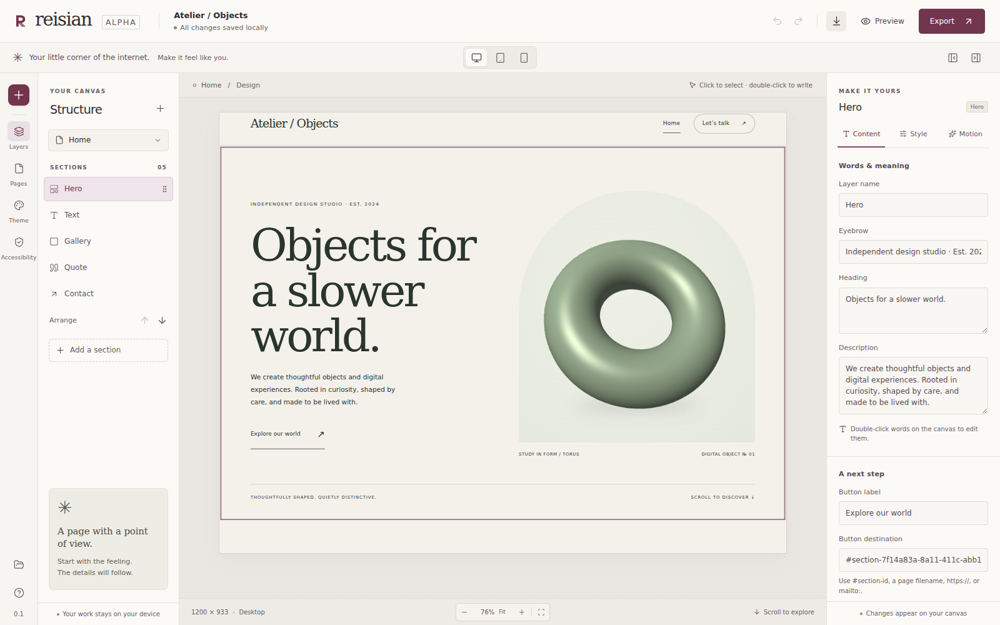

<p align="center">
  
</p>

<h1 align="center">당신의 감각이, 그대로 웹이 되는 곳.</h1>
<p align="center"><strong>Make the web feel like you.</strong></p>

레이시안은 코드를 쓰지 않고 웹사이트를 만드는 오픈소스 비주얼 스튜디오입니다. 글과 이미지, 색과 여백, 움직임과 3D 오브젝트를 눈으로 보며 조정하고, 내 컴퓨터에 프로젝트를 저장하고, 독립적인 웹사이트로 내보냅니다.

> AI Native 시대에서 물고기보다 물고기를 잡는 낚시대로써

Reisian is a local-first, visual-only website builder built with Electron, React and TypeScript. It gives you an instrument for expressing your own ideas: edit on a canvas, choose clear controls and keep your work in portable files.

**Status: working alpha under active development.** This is an early section-based editor, with a focused set of controls and presets. It does not claim feature parity with mature commercial builders or production readiness on every desktop platform. See [current limitations](#current-limitations) and the [roadmap](docs/ROADMAP.md).



*The actual alpha editor. [3D controls](docs/assets/studio-scene.png) · [Mobile artboard](docs/assets/studio-mobile.png).*

## A studio, on your computer

- **Visual authoring:** double-click section text on the canvas, edit individual card/gallery items in the inspector, and arrange sections with drag or button/keyboard alternatives.
- **A coherent site:** manage pages, titles and descriptions; adjust theme colors, typography, spacing and alignment.
- **Expressive defaults:** start with an editorial template, choose scroll-motion presets and configure a procedural WebGL sculpture through visual controls.
- **Responsive preview:** inspect desktop, tablet and mobile widths with the same page renderer used for export.
- **Your files:** use undo/redo and local autosave, save and open `.reisian` projects, and export a ZIP of standalone website files.
- **Accessible authoring:** inspect heading, alternative-text and contrast feedback; preserve visible focus and respect reduced-motion preferences in generated sites.

The editor has no code-entry panel. Core authoring does not require an account, hosted rendering service, AI API key or cloud project storage. Uploaded raster images are embedded; remote image URLs are rejected. Generated pages use local CSS and JavaScript with no required CDN. Authored external links still take visitors to external destinations when followed.

## Run it

Requires **Node.js 22.12 or newer** and npm. Clone this repository, enter its directory, then install the locked dependencies:

```sh
git clone https://github.com/hslcrb/reisian.git
cd reisian
npm ci
```

### Desktop development

```sh
npm run dev:desktop
```

This starts the local development server and Electron. To launch the built application instead:

```sh
npm run build
npm run desktop
```

Electron needs a graphical desktop session. Linux containers may require additional system libraries and a virtual display for automated tests.

### Browser development

```sh
npm run dev
```

Open the local URL printed by Vite. The browser surface supports editor development; native file dialogs and desktop security boundaries must be exercised in Electron.

### Local verification and packaging

| Command | Purpose |
| --- | --- |
| `npm run format:check` | Check source formatting |
| `npm run check` | Type checking, unit tests and production build |
| `npm run test:e2e` | Build and test the production editor in Chromium |
| `npm run test:desktop` | Native Electron smoke test; needs a display |
| `npm run package` | Build a Linux unpacked application directory |
| `npm run package:win` | Build a Windows portable package; requires an appropriate build environment |

If Chromium is missing, install the test browser with `npx playwright install chromium`. On headless Linux, run desktop smoke tests with `xvfb-run -a npm run test:desktop` after installing the required display and system dependencies. The integrated Linux application and its unpacked package passed native smoke checks. The Windows portable target is cross-built and unsigned; Windows runtime and macOS builds have not been verified. See the [delivery report](docs/agent-brain/2026-10-24-delivery.md) for exact evidence, artifacts and container-specific test limits. This repository uses local checks and does not use GitHub Actions workflows.

## Make your first site

1. Start with Atelier, Portfolio or a blank project.
2. Select a section and edit its content. Add, duplicate, remove or reorder sections using the canvas and controls.
3. Adjust the theme, links, image alternatives and page information. Choose motion and sculpture settings if they serve your content.
4. Preview at different widths, try the keyboard flow and review accessibility findings.
5. Save a **`.reisian` project** to keep editing later. Export a **website ZIP** when you want standalone HTML, local assets, CSS and JavaScript.

`.reisian` is the editable source document; the ZIP is the published-site output. Keep the project file alongside your export. Exporting creates local files and does not deploy or publish a site. Extract the ZIP and serve its contents with any static web host or local static server, preserving the generated folder structure. No Reisian backend is required to run the exported site.

프로젝트 파일은 다음 편집을 위한 원본이고, ZIP은 웹사이트 배포를 위한 결과물입니다. 내보내기만으로 인터넷에 공개되지는 않습니다. 배포 전에는 다양한 화면 크기와 키보드 조작, 링크, 이미지 설명과 실제 콘텐츠를 직접 확인해 주세요.

## Current limitations

- Layout is based on the supported section types and controls. Arbitrary DOM editing, custom code entry, third-party scripts, commerce, authentication and a hosted CMS are outside this alpha.
- Motion uses presets; 3D uses procedural geometry and materials. There is no full animation timeline, imported 3D-model editor or complex scene authoring system.
- Accessibility feedback covers titles, visible headings, image alternatives, selected links, movement reminders and solid-color text contrast. Automated editor testing excludes the canvas iframe and checks for serious/critical violations; a separate default-export scan covers that fixture. Neither is a complete WCAG audit or a guarantee that every exported site is accessible. Authors must review meaning, reading order, image-backed contrast, keyboard use and assistive-technology behavior.
- WebGL availability depends on the browser and graphics environment. Generated pages provide a static alternative and respect reduced motion; test the exported result on your intended devices.
- Local autosave is a convenience, not a backup. Save separate project files before significant changes. Browser storage can be cleared, and future schema migrations may require attention.
- Linux native and packaged smoke checks ran in a root container with an explicit test-only OS sandbox exception and software graphics. Production Electron keeps context isolation and renderer sandbox settings enabled. Windows artifacts are unsigned and have not been run on Windows; macOS was not built. There is no automatic update service.
- Interface copy is currently English; project content accepts Korean and other Unicode text. The bilingual documentation does not imply complete interface localization.

## Project map

| Path | Responsibility |
| --- | --- |
| `src/core/` | Project schema, templates, commands, history, checks, rendering and export |
| `src/runtime/` | Exported-site motion and WebGL behavior |
| `src/editor/` | Canvas, panels, controls and editor state |
| `electron/` | Isolated desktop host, narrow IPC and native file operations |
| `public/brand/` | Original vector identity and palette |
| `docs/agent-brain/` | Implementation handoffs and verification evidence |

## Build it with us

See [Contributing](CONTRIBUTING.md), [Security](SECURITY.md), [Community conduct](CODE_OF_CONDUCT.md), [Brand guidelines](docs/brand.md) and the [Roadmap](docs/ROADMAP.md). Korean and English contributions are welcome. Keep changes small, publish each cohesive commit, and preserve merge history as described in [AGENTS.md](AGENTS.md).

The software and original brand artwork are available under the [MIT license](LICENSE). Copyright © 2026 이호세 (hslcrb) and Reisian contributors. Third-party dependencies retain their own licenses.
