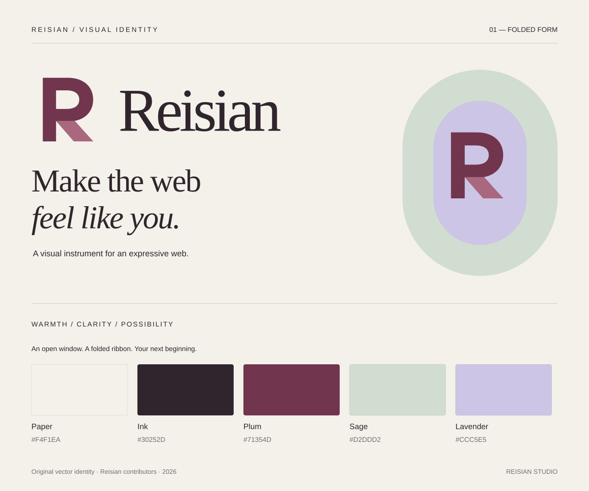

# Reisian identity / 레이시안 브랜드

**Make the web feel like you.**  
**당신의 감각이, 그대로 웹이 되는 곳.**

Reisian is a visual instrument: warm enough to invite experimentation, precise enough to help someone finish. Our identity pairs an original folded R with quiet editorial typography. The open counter suggests a window; the diagonal leg unfolds into a new direction. Keep the experience useful, personal and calm.

## Assets

| File | Intended use |
| --- | --- |
| [`reisian-mark.svg`](../public/brand/reisian-mark.svg) | Primary two-color symbol on pale surfaces |
| [`reisian-wordmark.svg`](../public/brand/reisian-wordmark.svg) | Horizontal symbol and name, documentation and introductions |
| [`reisian-app.svg`](../public/brand/reisian-app.svg) | Original vector app tile |
| [`reisian-app.png`](../public/brand/reisian-app.png) | 512 × 512 raster icon for Electron and Linux packaging |
| [`reisian-app.ico`](../public/brand/reisian-app.ico) | Windows icon with seven sizes: 16, 24, 32, 48, 64, 128 and 256 pixels |
| [`reisian-mark-ink.svg`](../public/brand/reisian-mark-ink.svg) | Single-color dark symbol, small sizes and print |
| [`reisian-mark-paper.svg`](../public/brand/reisian-mark-paper.svg) | Single-color light symbol on dark surfaces |
| [`reisian-wordmark-ink.svg`](../public/brand/reisian-wordmark-ink.svg) | Single-color horizontal lockup |
| [`brand-board.svg`](../public/brand/brand-board.svg) | Overview and reference |
| [`palette.json`](../public/brand/palette.json) | Portable named swatches |

All symbols are native vector paths with no embedded raster images, scripts, external images or network fonts. Every SVG includes a title and description. The PNG and ICO are raster derivatives of the original app tile; the packaging configuration references them for native application branding. Wordmark lettering uses `Georgia, Times New Roman, serif`; installed fonts can change its precise letterforms. The core symbol is independent of font availability. Brand artwork is included under the repository's MIT license; do not imply that a fork is an official Reisian release.

## Palette

| Name | Hex | Role |
| --- | --- | --- |
| Paper | `#F4F1EA` | Primary canvas and quiet surfaces |
| Ink | `#30252D` | Text, structure and monochrome marks |
| Plum | `#71354D` | Main action, selected state and identity |
| Sage | `#D2DDD2` | Gentle secondary surfaces |
| Lavender | `#CCC5E5` | Occasional creative accent |
| Fold | `#A9687E` | Decorative fold inside the symbol only |

Calculated sRGB contrast ratios for solid, opaque pairs: ink/paper **13.04:1**, plum/paper **8.03:1**, ink/sage **10.51:1**, ink/lavender **8.88:1**, plum/sage **6.48:1**, plum/lavender **5.47:1**. These measurements describe only these exact color pairs, not interface conformance. Do not use sage or lavender as text on paper. Recheck contrast after opacity, gradients, overlays or user theme changes.

## Placement and scale

Use at least one stem-width of clear space around the visible mark. The 144-unit mark includes that space inside its view box. Display the mark at 24 CSS pixels or larger; prefer the ink variant below 32 pixels. Display the wordmark at 180 pixels wide or larger. Preserve the view box and proportions. Do not skew, outline, add shadows to, or place the primary mark on a busy photograph. On ink or plum, use the paper mark.

When an adjacent heading already says “Reisian,” use `alt=""` on a decorative `` to avoid repeating the name. If the symbol is the only label for a link, give the link an accessible name such as “Reisian home.” SVG title/description alone does not replace naming the interactive control.

## Typography and voice

Use a system sans-serif stack for dense editing controls and a restrained serif for editorial canvas headings. Keep text legible and controls explicit. Never replace a useful label with a decorative icon. Korean copy should sound direct and welcoming: “프로젝트 저장”, “페이지 추가”, “미리보기”. English follows the same pattern: “Save project”, “Add page”, “Preview”.

Describe what someone can do and explain the next step. Avoid claims of instant perfection, universal accessibility or commercial feature parity. A successful Reisian page should feel like its author; the editor should make their choices understandable.
